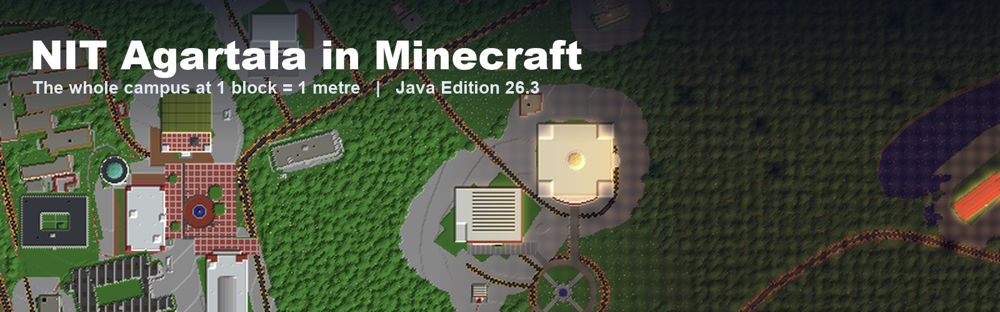

<h1 align="center">NIT Agartala in Minecraft</h1>

<p align="center">
The whole NIT Agartala campus, rebuilt at full size in Minecraft Java Edition.<br>
Walk in through the main gate, find your hostel, climb through the Library's three floors and explore every road on campus.
</p>

<p align="center">
<a href="../../releases/latest/download/NIT_Agartala_world_26.3.zip"></a>
</p>

<p align="center">


</p>

Every road, hostel, hill and pond sits where it is on the ground at Barjala, Jirania, because one block is one metre both across and up. The layout comes from real map data, and the main buildings were designed by hand from campus tour videos, so a student should recognise the place on sight. You can use it to show a friend round campus, run a treasure hunt, plan an event or build something new on top of it.

## Play it in three steps

**1. Download the world.** Click the green button above, or open the [latest release](../../releases/latest) and download `NIT_Agartala_world_26.3.zip`.

**2. Unzip it into your `saves` folder.** You should end up with a folder called `NIT Agartala` that has `level.dat` directly inside it.

| Your computer | Where the `saves` folder is |
| --- | --- |
| Windows | Press <kbd>Win</kbd> + <kbd>R</kbd>, type `%appdata%\.minecraft\saves` and press Enter |
| macOS | In Finder, choose Go, then Go to Folder, and type `~/Library/Application Support/minecraft/saves` |
| Linux | `~/.minecraft/saves` |

**3. Open Minecraft Java Edition 26.3 or newer.** Choose Singleplayer and pick **NIT Agartala** from the list.

You start in Knowledge Park, in creative mode, with cheats on. If the world does not show up, check that the folder is not nested twice (as in `saves/NIT Agartala/NIT Agartala`) and that the game version is 26.3 or newer. The world does not work in Bedrock Edition.

To play it with friends, copy the `NIT Agartala` folder into your server folder, rename it to `world`, and start the server as usual.

## Where to go first

Type these in chat (press <kbd>T</kbd>) to jump straight there. [docs/BUILDINGS.md](docs/BUILDINGS.md) has all 30 named buildings.

| Place | Command |
| --- | --- |
| Knowledge Park and the Vivekananda statue | `/tp @s 571 76 1215` |
| Central Library | `/tp @s 872 76 1245` |
| Administrative Block | `/tp @s 593 76 1250` |
| Swami Vivekananda Seminar Hall | `/tp @s 565 78 1195` |
| RNT Hostel and Dining Hall | `/tp @s 926 80 790` |
| Aryabhatta Hostel | `/tp @s 540 90 870` |
| Gargi Girls Hostel | `/tp @s 1270 95 850` |
| ABV Sports Complex | `/tp @s 1131 76 375` |
| Campus lake | `/tp @s 1180 72 1160` |
| Main gate | `/tp @s 656 66 1650` |

Try `/time set night` to see the campus lit up, and `/gamemode survival` if you want to walk it on foot.

## The campus

| By day | At night |
| --- | --- |
| 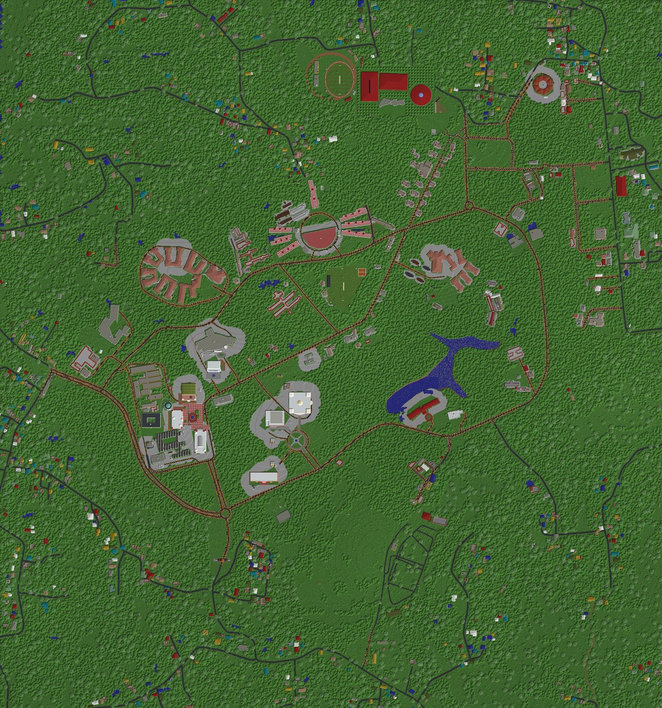 | 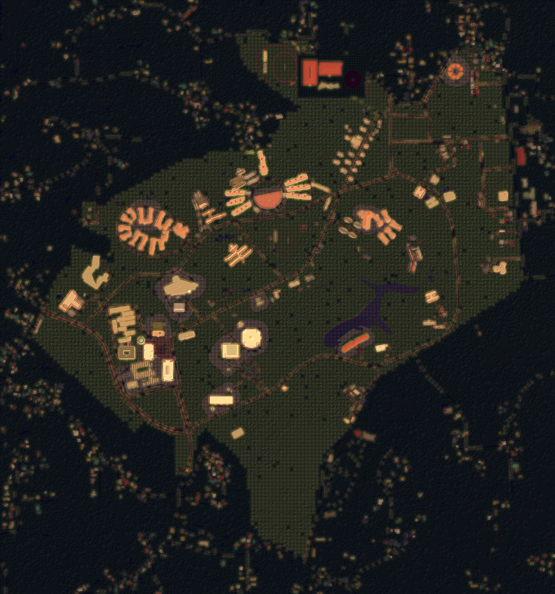 |

The model covers about 1.9 by 2.0 km. It includes the whole campus inside the wall, the villages round it, the real rise and fall of the ground, every road and footpath, the lake, the ponds and the playing fields. This layout is the strongest part of the project. Building outlines, road lines and heights come from map data, so distances and directions match the real campus.

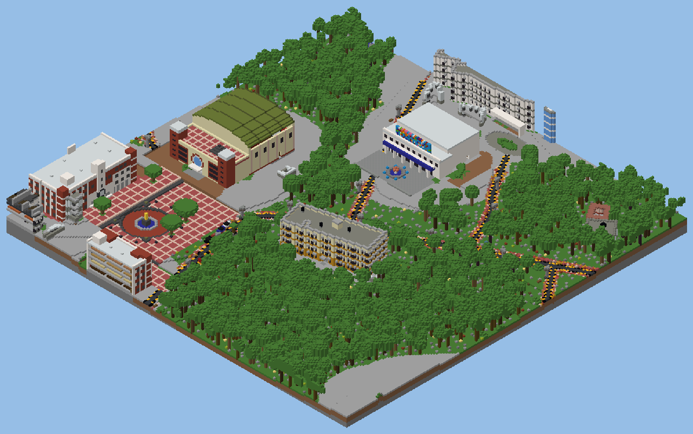

This is the academic core. The SAC and the Administrative Block face each other across Knowledge Park and the Swami Vivekananda statue. Behind them stand the Swami Vivekananda Seminar Hall with its green curved roof and the Visvesvaraya Auditorium with its fountain forecourt.

| | |
| --- | --- |
| 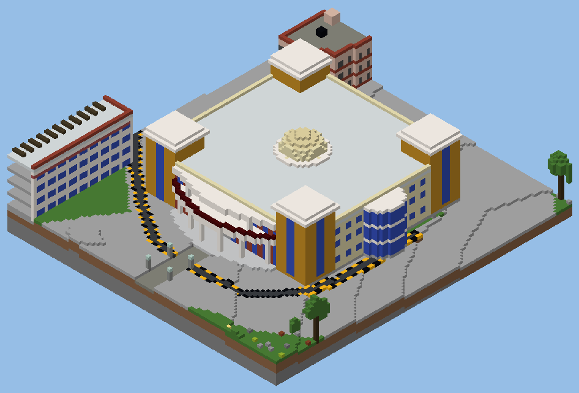 | 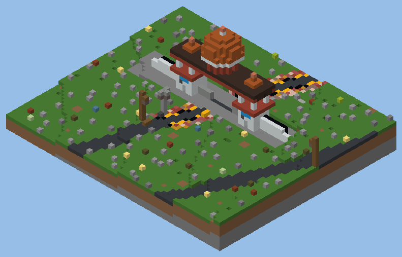 |
| Central Library (Knowledge Centre) | Main gate, Gate No. 1 at Jirania |
| 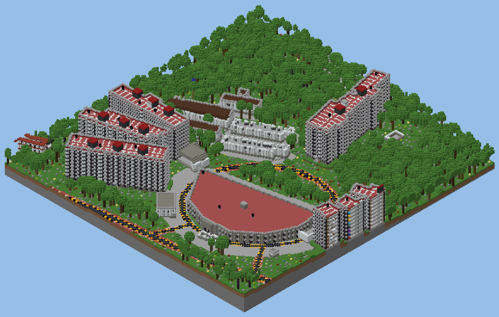 | 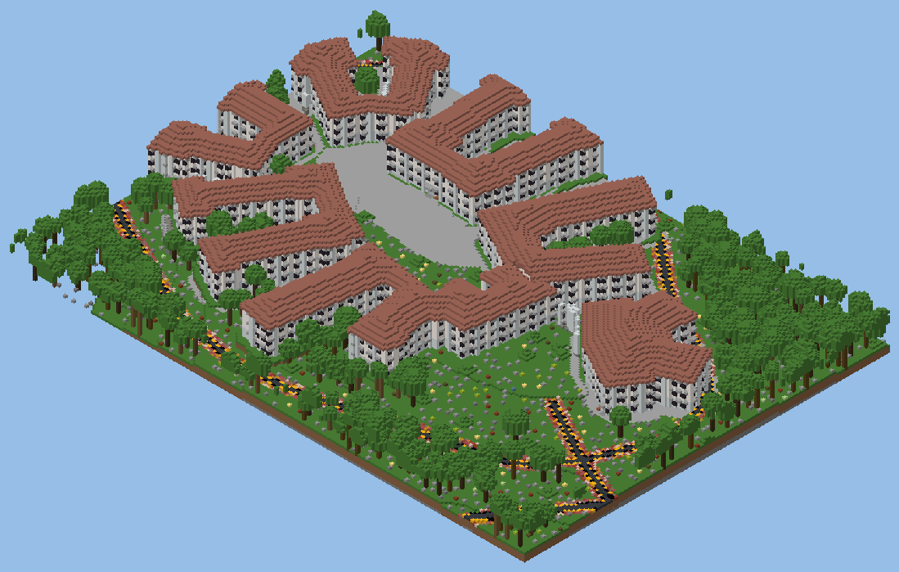 |
| RNT Hostel towers and the Dining Hall | Aryabhatta Hostel round its oval garden |
| 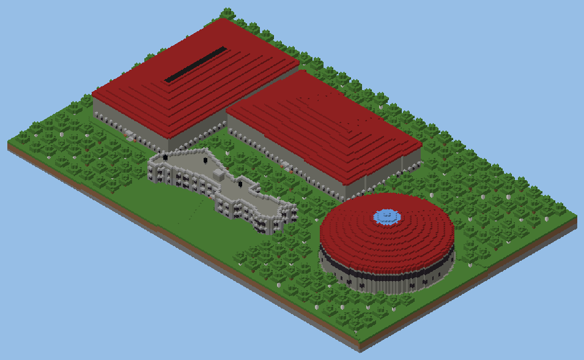 | 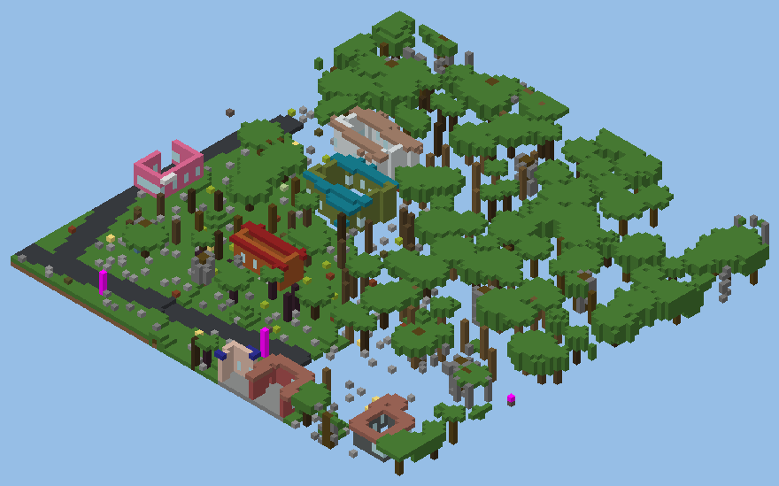 |
| ABV Sports Complex | Village houses outside the wall, roofs cut away |

Roads have kerbs, footpaths and street lamps with benches and bins. Trees, grass and flowers cover open ground, and about 1,200 people (armour stands, so they never wander off) stand around campus or sit at desks.

## Ideas for what to do with it

- Run a **treasure hunt** or a scavenger hunt across campus, with clues hidden in the Library, the messes and the hostels.
- Give new students a **virtual tour** before they arrive, or plan the route for an event or a fest.
- **Build your own things** on top of it, such as a dream department, a new hostel or a festival stage.
- Make a **video or a short film** with the campus as the set.
- Host it on a **server** for your friends and explore it together.
- Fix or improve a building you know well and send it back (see below).

## How close is it to the real campus?

The outside of the campus is the part to trust. Here is an honest account of the rest.

- **Interiors are placeholders.** The rooms were furnished by a script so that buildings are not empty shells. Desks, beds, shelves and tables are placed by room size and type, and they are not based on the real rooms. The Library, the two auditoriums, the hostel rooms and the two messes got a little more care, but they are still guesses at what is inside.
- **Unnamed buildings are styled, not copied.** About 970 buildings have their real outline and position, but their colours, windows and roofs were made up. Only the 30 named buildings in [docs/BUILDINGS.md](docs/BUILDINGS.md) were designed from photos and videos.
- **Some places are guesses.** The Aryabhatta mess location, the position of Gate No. 3, and several department buildings in the west academic cluster are not yet tied to a name. Faculty Quarters and the Dhalai, Gomati, Howrah and Saima hostels have not been built from references yet.
- **Floors are joined by ladders.** Most buildings have no real staircases yet.
- **There are small glitches.** You may find a roof that does not quite meet its wall, a tree too close to a building, a lamp in an odd spot or a dark corner. Please report them.
- **The rules are set for exploring.** Nothing grows, decays or drops items, and no mobs spawn. This keeps the map from changing on its own. You can change it with game rules such as `/gamerule block_drops true`.

## Inside (placeholder interiors)

The pictures below slice the roof off just above one floor. Treat them as stand-ins until someone who knows the real rooms improves them.

| | |
| --- | --- |
| 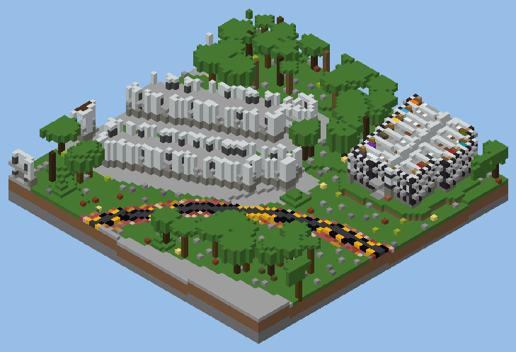 | 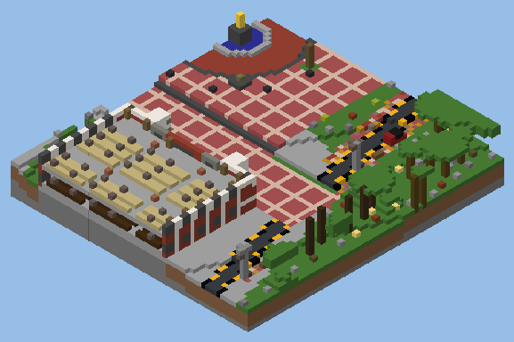 |
| RNT hostel rooms, each with a bed, desk, chest and rug | Classrooms with a board and rows of desks |
| 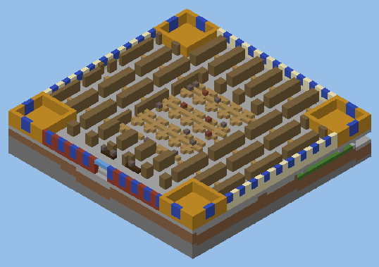 | 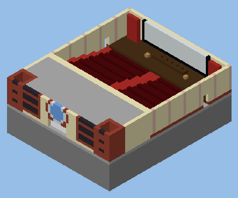 |
| Library stacks, reading tables and lecterns | Seminar hall seating, stage and screen |

## Help build it

You do not need to know how to code. You can report a glitch, send photos of a building you know, or pick one small part of the map and improve it. AI coding agents are welcome, so you can describe what you want and let your agent write the change. [CONTRIBUTING.md](CONTRIBUTING.md) lists the open jobs and walks you through every step.

## By the numbers

| | |
| --- | --- |
| Area | about 1.9 by 2.0 km (x 32 to 1887, z 64 to 2047) |
| Scale | 1 block = 1 metre |
| Named buildings designed by hand | 30 |
| Other buildings, from their real outlines | about 970 |
| Rooms with placeholder furniture | about 1,000 |
| People on campus | about 1,200 |

## How it was made

The terrain and building outlines come from OpenStreetMap, Microsoft building footprints and a public elevation model. The named buildings were designed from three public campus tour videos, the official campus map and the satellite view. Every step is a Python script that edits the world through the official Minecraft server, and a whole-world check makes sure nothing floats or falls. [docs/HOW_IT_WORKS.md](docs/HOW_IT_WORKS.md) explains the pipeline.

```
tools/          base layer: map data to terrain and first buildings
tools/hand/     hand layer: one script per building, plus interiors, roads, lights, people and checks
data/osm/       OpenStreetMap extract of the campus
data/model/     height field, masks and footprints in world coordinates
docs/           guides and the pictures in this README
```

## Licence and credits

The code and documentation are under the [MIT License](LICENSE). Map data is © OpenStreetMap contributors, and the building footprints come from Microsoft's Global ML Building Footprints. Both are under the Open Database License, so keep this credit when you share the world or anything built from it. The tour videos used as references belong to their creators and are not included here. Minecraft is a trademark of Mojang Studios. This project is made by students and is not affiliated with Mojang, Microsoft or NIT Agartala.
